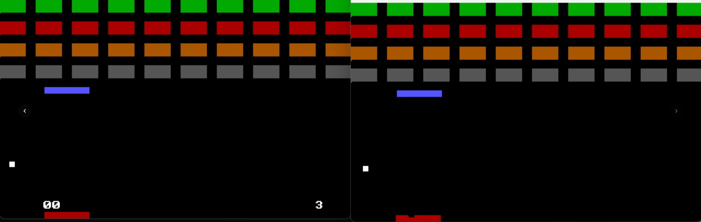
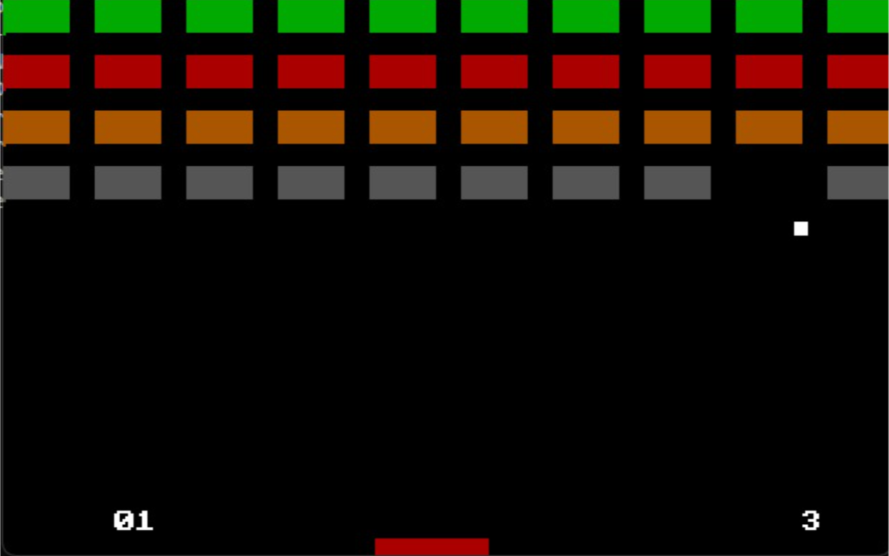

# 8086 Assembly Brick Breaker & Serial Arcade

A retro **Brick Breaker (Breakout)** arcade game and **Dual-Pane Serial Chat** client written entirely in **16-bit x86 Assembly** for MS-DOS.

The project combines low-level game development with direct hardware programming: VGA graphics through BIOS services, keyboard polling, and direct UART communication through the **8250/16550-compatible COM1 serial port**.

---

## Screenshots

### Multiplayer Mode

The multiplayer mode runs across two connected DOSBox instances. The Host controls the main game state and ball physics, while the Joined player controls the second paddle.



### Single-Player Mode

Classic Brick Breaker gameplay with colored brick rows, ball physics, paddle control, score tracking, and lives.



---

## Features

- **Single-Player Brick Breaker**
  - 40 color-coded bricks arranged in a 4 × 10 grid.
  - Paddle movement using the keyboard.
  - Ball collision and directional deflection.
  - Score tracking.
  - Three-life game loop.
  - Brick destruction state tracking.

- **Real-Time Serial Multiplayer**
  - Peer-to-peer communication over COM1.
  - DOSBox null-modem networking support.
  - Host-authoritative ball physics.
  - Remote paddle synchronization.
  - Compact command/state protocol.
  - Handshake and win/loss confirmation.

- **Dual-Pane Serial Chat**
  - 80 × 25 text-mode terminal.
  - Separate local and remote display panes.
  - Real-time serial communication.
  - Independent line scrolling.
  - BIOS keyboard and video services.

- **Direct Hardware / BIOS Programming**
  - VGA Mode 13h graphics.
  - Direct UART register access.
  - Non-blocking keyboard polling.
  - DOS and BIOS interrupt services.
  - Designed for 8086/8088 real-mode environments.

---

## Game Modes

The main menu provides three modes:

| Key | Mode | Description |
|---|---|---|
| `S` | Single Player | Play the classic Brick Breaker game. |
| `M` | Multiplayer | Connect two DOSBox instances through COM1. |
| `C` | Serial Chat | Use COM1 as a split-screen terminal. |
| `Esc` | Exit | Return to DOS. |

### In-Game Controls

| Key | Action |
|---|---|
| `A` | Move paddle left |
| `D` | Move paddle right |
| `Space` | Launch / release the ball |
| `Esc` | Return to the main menu |

---

## Game Mechanics

### Brick Layout

The game contains **40 bricks** arranged in four rows and ten columns.

```text
+-------------------------------------------------------+
| [01] [02] [03] [04] [05] [06] [07] [08] [09] [10]   |
| [11] [12] [13] [14] [15] [16] [17] [18] [19] [20]   |
| [21] [22] [23] [24] [25] [26] [27] [28] [29] [30]   |
| [31] [32] [33] [34] [35] [36] [37] [38] [39] [40]   |
+-------------------------------------------------------+
```

### Ball Physics

The horizontal velocity of the ball depends on where it hits the paddle:

- **Center hit:** `Vx = 0`
- **Left-side hit:** `Vx = -1`
- **Right-side hit:** `Vx = 1`

A paddle collision reverses the vertical velocity:

```text
Vy = -Vy
```

This produces different reflection angles depending on the collision position.

### Brick Collision

A 40-byte boolean array, `IsDestroied`, tracks the state of every brick.

```text
0 → Brick is active
1 → Brick is destroyed
```

When the ball hits a brick:

1. The brick is marked as destroyed.
2. The vertical ball velocity is inverted.
3. The score is updated.
4. The destroyed brick index can be sent to the remote player.
5. An audible beep is generated.

---

## Multiplayer Architecture

The multiplayer implementation uses a **Host / Joined Player** architecture.

### Host

The Host is responsible for the authoritative game state:

1. Calculates ball movement.
2. Detects ball collisions.
3. Handles brick destruction.
4. Updates the score.
5. Sends game-state updates to the Joined player.
6. Processes remote paddle commands.

### Joined Player

The Joined player:

1. Connects to the Host through COM1.
2. Sends paddle movement commands.
3. Receives ball and game-state updates.
4. Renders the synchronized game state.

This approach keeps ball physics centralized on the Host instead of allowing both machines to independently simulate the ball.

---

## Serial Communication Protocol

The multiplayer protocol uses compact byte-oriented commands.

| Value / Bitfield | Meaning |
|---|---|
| `0x01` | Host handshake / Win confirmation |
| `0x02` | Client acknowledgement / Loss confirmation |
| `0x03` | Remote score increment |
| `11111110b` | Joined paddle: Left |
| `11111111b` | Joined paddle: Right |
| `1110xxxxb` | Host update: stationary paddle + ball `(Vx, Vy)` |
| `111100xxb` | Host update: paddle moving left + ball `(Vx, Vy)` |
| `111101xxb` / `111111xxb` | Host update: paddle moving right + ball `(Vx, Vy)` |
| `AH` | Destroyed brick index payload |

The protocol is intentionally compact because the target environment is a 16-bit real-mode system communicating over a low-bandwidth serial link.

---

## UART Configuration

The project directly programs the **COM1 UART** through I/O ports.

### COM1 Base Address

```text
0x3F8
```

### Configuration

```assembly
Port 0x3FB (LCR)  <- 10000000b  ; Enable DLAB
Port 0x3F8 (DLL)  <- 0x0C       ; Baud divisor low byte
Port 0x3F9 (DLM)  <- 0x00       ; Baud divisor high byte
Port 0x3FB (LCR)  <- 00011011b  ; 8 data bits, 1 stop, even parity
```

### Serial Parameters

| Parameter | Value |
|---|---|
| Port | COM1 |
| Base Address | `0x3F8` |
| Baud Rate | 9600 |
| Data Bits | 8 |
| Stop Bits | 1 |
| Parity | Even |
| UART | 8250 / 16550 compatible |

---

## Hardware & BIOS Interfaces

### VGA Graphics

The game uses VGA **Mode 13h**:

```text
Resolution: 320 × 200
Colors:     256
```

Video operations are performed through BIOS `INT 10h`.

### Keyboard

Keyboard input uses BIOS `INT 16h`.

The game uses non-blocking keyboard polling so that input can be checked while the game loop continues running.

### Serial Port

UART communication is performed using x86 `IN` and `OUT` instructions rather than a high-level operating-system serial API.

Important COM1 registers include:

```text
0x3F8  Data Register
0x3F9  Interrupt Enable Register
0x3FA  Interrupt Identification / FIFO Control
0x3FB  Line Control Register
0x3FC  Modem Control Register
0x3FD  Line Status Register
```

---

## DOS / BIOS Interrupts

| Interrupt | Function |
|---|---|
| `INT 10h` | Video services |
| `INT 10h / AH=00h` | Set video mode |
| `INT 10h / AH=0Ch` | Plot pixel |
| `INT 10h / AH=02h` | Set cursor position |
| `INT 10h / AH=06h` | Scroll text window |
| `INT 16h / AH=01h` | Check keyboard status |
| `INT 16h / AH=00h` | Read keyboard input |
| `INT 21h / AH=09h` | Print string |
| `INT 21h / AH=02h` | Print character |
| `INT 21h / AH=4Ch` | Terminate program |

---

## Serial Chat

The project also includes a split-screen serial terminal.

```text
+------------------------------------------------+
|              LOCAL / SENT DATA                 |
|                                                |
|  > Hello from Host                             |
|  > Ready?                                      |
|                                                |
|------------------------------------------------|
|              REMOTE / RECEIVED DATA            |
|                                                |
|  < Hello from Client                           |
|  < Yes!                                        |
|                                                |
+------------------------------------------------+
```

The terminal uses text mode `03h` with an 80 × 25 character display.

Local and remote messages are displayed in separate regions, and each pane can scroll independently.

---

## Project Architecture

```text
                    +----------------------+
                    |      Main Menu       |
                    +----------+-----------+
                               |
              +----------------+----------------+
              |                |                |
              v                v                v
       +-------------+  +-------------+  +-------------+
       | Single      |  | Multiplayer |  | Serial Chat |
       | Player      |  | Mode        |  | Mode        |
       +------+------+  +------+------+  +------+------+
              |                |                |
              |          COM1 / UART            |
              |                |                |
              v                v                v
       +------------------------------------------------+
       |              BIOS / DOS Services               |
       | INT 10h | INT 16h | INT 21h                    |
       +------------------------------------------------+
                              |
                              v
                   +----------------------+
                   | PC Hardware / VGA /  |
                   | UART / Keyboard      |
                   +----------------------+
```

---

## Target Environment

- **CPU:** Intel 8086 / 8088 / 80286+
- **Architecture:** x86
- **Execution Mode:** 16-bit Real Mode
- **Operating System:** MS-DOS
- **Memory Model:** `.MODEL SMALL`
- **Code Segment:** 64 KB
- **Data Segment:** 64 KB
- **Stack:** 64 bytes
- **Graphics:** VGA Mode 13h
- **Serial Port:** COM1
- **Assembler:** TASM or MASM 6.11

---

## Building the Project

### Requirements

- DOSBox, DOSBox-X, or DOSBox-Staging
- Borland Turbo Assembler (**TASM**) and Turbo Linker (**TLINK**)
- Or Microsoft Macro Assembler (**MASM 6.11**)

### TASM / TLINK

Place `game.asm` in your DOS working directory:

```dos
tasm /zi game.asm
tlink /v game.obj
game.exe
```

---

## Testing Multiplayer with DOSBox

Two DOSBox instances can be connected locally through a virtual null-modem TCP connection.

### Instance 1 — Host

Configure COM1 as the server:

```ini
[serial]
serial1=nullmodem port:5000 server:1
```

### Instance 2 — Client

Configure COM1 as the client:

```ini
[serial]
serial1=nullmodem port:5000 server:0
```

### Run

1. Start DOSBox Instance 1.
2. Run `game.exe`.
3. Select `M` for Multiplayer.
4. Start DOSBox Instance 2.
5. Run `game.exe`.
6. Select `M` on the second instance.
7. The two instances establish communication through the virtual COM1 connection.

The same configuration can be used to test the split-screen serial chat by selecting `C`.

---

## Learning Objectives

This project demonstrates practical low-level programming concepts including:

- 8086 Assembly
- x86 Real Mode
- BIOS interrupts
- DOS interrupts
- VGA Mode 13h
- Pixel-level graphics
- Game loops
- Collision detection
- Basic game physics
- Keyboard polling
- UART programming
- Direct hardware I/O
- Serial communication
- Null-modem communication
- Multiplayer synchronization
- State serialization
- Memory management in a 16-bit environment

---

## Project Highlights

The project is designed to demonstrate how a complete interactive application can be implemented close to the hardware level, without relying on modern operating-system graphics or networking APIs.

It combines:

**Game Development + Assembly + VGA Graphics + Hardware I/O + Serial Communication + Multiplayer Synchronization**

into a single 16-bit DOS application.

---

## License

This project is intended for educational and experimental purposes.
